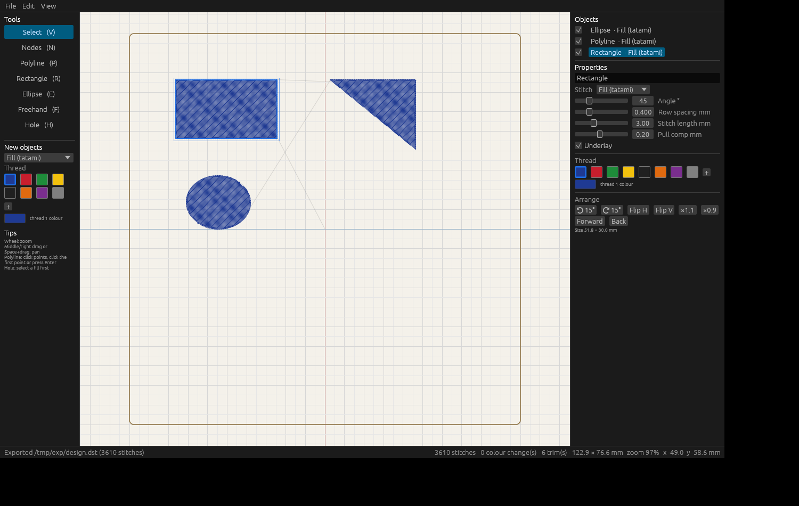

# EmbroideryCraft

A **free, open-source embroidery digitizer** written in Rust, aiming at the capabilities of professional
digitizing software (object-based stitch generation, underlay, pull compensation, lettering, auto-digitizing,
Tajima/DST and other machine formats) in a vector-editor workflow.

> **Status: early alpha (v0.1).** The core engine and a command-line tool exist; there is no graphical editor yet.
> Output has been checked with an independent DST decoder but **not yet sewn on a real machine**: see
> [docs/MACHINE_TESTING.md](docs/MACHINE_TESTING.md) before trusting it with real fabric.

## What works today

| Area | State |
|---|---|
| Tajima **DST** read/write (header, ±12.1 mm record splitting, jumps, colour changes, trims) | working, cross-checked with pyembroidery |
| **Running stitch**, triple run | working |
| **Satin column** from a centre line + width, or two rails; centre / edge / centre+edge underlay; pull compensation; long-stitch splitting | working |
| **Tatami fill** of polygons with holes; any angle; brick offsets; underlay; pull compensation; strip-wise sequencing so holes are not crossed | working |
| Design object model (JSON), sequencing, tie-in/tie-off, trims, colour changes, merge-by-colour, auto-centre | working |
| SVG stitch preview | working |
| **Appliqué** (placement line, stop, tack-down run or zigzag, stop to cut, satin border) | working |
| SVG import, auto-digitize, other machine formats | planned, see [ROADMAP.md](ROADMAP.md) |
| GUI editor (draw, stitch type, live preview, export DST, undo/redo, save/load) | **v0.2** — `cargo run -p embcraft-gui --release` |

## Try it

```sh
cargo run -p embcraft -- demo my.json                     # write an example design
cargo run -p embcraft -- build my.json -o my.dst --svg my.svg
cargo run -p embcraft -- info my.dst
```

`examples/demo.json` and `examples/demo-preview.svg` show a ring (tatami with a hole), a satin wave and a
triple-run triangle.

## Layout

| Crate | Role |
|---|---|
| `embcraft-core` | points, stitches, threads, patterns, SVG preview |
| `embcraft-dst` | DST reader/writer |
| `embcraft-stitch` | run / satin / tatami generators |
| `embcraft-design` | parametric object list → machine-ready pattern |
| `apps/embcraft` | CLI |

The object list, not the stitch list, is the source of truth: edit a parameter, rebuild. Crates are layered
(`core` ← `dst`, `stitch` ← `design` ← apps) and have no UI dependencies, so a GUI can be added on top.
Coordinates are millimetres, y down.

## Principles

- **Never crash on bad input.** No `unwrap`/`expect`/`panic!` in library code (enforced by clippy); errors are
  returned. File readers must survive garbage.
- **Deterministic output**, property-tested stitch limits.
- **Clean-room.** Capabilities are documented in [docs/WILCOM_FEATURES.md](docs/WILCOM_FEATURES.md) from public
  documentation. Do not copy code from commercial or GPL/AGPL software (Ink/Stitch is GPL).
- Free forever: MIT OR Apache-2.0.

## Relationship to VectorCraft

The intention is to build on the ideas, and later the permissively licensed crates, of the open-source
[VectorCraft](https://github.com/storytold/vectorcraft) vector editor (geometry, path operations, tracing,
text, UI). See [docs/VECTORCRAFT_REUSE.md](docs/VECTORCRAFT_REUSE.md). This project is **not affiliated with**
the VectorCraft/ArtCraft team; the source is licensed so that they, or anyone, can adopt it.

## License

MIT OR Apache-2.0, at your option. See `LICENSE-MIT`, `LICENSE-APACHE`, `NOTICE`.


## GUI (v0.2)

```
cargo run -p embcraft-gui --release            # needs Rust (rustup.rs)
cargo run -p embcraft-gui --release -- --demo  # start with sample objects
```

Tools: Select (V), Nodes (N), Polyline (P), Rectangle (R), Ellipse (E), Freehand (F), Hole (H). Ctrl+Z/Y undo/redo,
Ctrl+S/O/N project, Ctrl+E export DST, Ctrl+D duplicate, `0` fit view. Projects use the `.embcraft` extension.

Also in the GUI:
- Icon toolbar for file, undo, arrange (rotate, flip, resize, sewing order), align and view toggles.
- Arrange menu: align selected objects, centre the selection (or whole design) in the hoop.
- Stitch player (Ctrl+P): watch the design sew out stitch by stitch, with trims marked.
- File › View machine file: open any DST read-only to check it, or pass it on the command line
  (`embcraft-gui trimtest.dst`).
- File › Trims in DST files: zero-move jumps per trim (set it from your trim test result).
- View › Hoop size: common hoop sizes or a custom size.
- Curve tool (B): Bézier pen; click for corners, click and drag for smooth curves.
- Text tool (T): click, type, pick any installed font; letters become fill or outline shapes
  (holes in O, A, B handled). Lettering code lives in `crates/text`.
- Start point tool (S): click on a shape where its sewing should begin; the design's first and last
  stitches are marked while this tool or the stitch player is active.
- Hover over any tool, stitch type or property for a short explanation.
- Select tool handles: drag a corner to resize (proportions kept; Shift for free), a side to
  stretch one way, the round handle above to turn (Shift: 15° steps).
- Group / Ungroup (Ctrl+G / Ctrl+Shift+G, Arrange menu): grouped objects are selected together.
  A click picks up a whole group or lettering; a double-click picks one object (one letter) out of it.
- Start points: every object begins exactly at its start point (fills and auto satin travel to
  their first row inside the shape). Properties › Start point also places it at a corner, the top
  or bottom centre or the middle of the shape.
- Machine start and end (Properties, with nothing selected): the hoop centre, or the middle, top
  or bottom centre or a corner of the design. DST files then start at that point and return to it.
- Shapes (Arrange menu, toolbar, properties): **Add**, **Subtract** (the shapes on top are cut out
  of the bottom one), **Overlap** and **Exclude overlap** on closed shapes, holes included.

### Satin lettering, Kanji, Kana and Hangul

- **Auto satin** (stitch type, and the default in the lettering window): any filled shape is split
  into strokes and each is sewn as satin straight across, with crossings carried through, wide
  strokes split, and travel stitches inside the shape instead of trims. Code: `crates/stitch/src/autosatin.rs`.
- **EmbroideryCraft fonts** (`.ecfont`, Fonts menu): convert a computer font once (Katakana,
  Hiragana, Latin, martial-arts Kanji/Hangul, or any characters you paste) and keep it, so
  lettering is instant and sews the same every time. Missing characters can be added later.
- **Font editor** (Fonts › Edit): each character opens on the canvas with guide lines and all the
  drawing tools; the **Satin direction** tool (D) changes which way the stitches run in any part
  of a stroke. **New blank font** draws a font from scratch.
- Vertical text (縦書き) for belts and gi; Japanese and Korean typed directly into the app.
- Fonts are kept in `~/.local/share/embroiderycraft/fonts` (Windows: `%APPDATA%\EmbroideryCraft\fonts`),
  or in `$EMBROIDERYCRAFT_FONTS`. Only convert fonts whose licence allows it (Noto CJK and other
  SIL Open Font Licence fonts do).
- Every font list shows each font's name drawn in that font (with 空手道 / 태권도 for Japanese and
  Korean fonts).

### Badges, retyping and team names

- **Text on an arc**: in the lettering window choose **Arc top** (letters standing outwards) or
  **Arc bottom** (reading left to right underneath) and a circle radius; arc text is centred on the
  point you clicked.
- **Lettering stays text**: clicking a letter selects the whole lettering; **Edit text…** in the
  properties retypes it, or changes its font, size or arc, in the place it was moved to.
- **Text along any line**: draw a line or shape, select it, and choose **Along a drawn line** in the
  lettering window (from its start, centred or to its end). The guide line can be taken out of the design.
- **Kerning**: **Auto kerning** closes up pairs such as AV, To and LT from the letter shapes (any
  font, EmbroideryCraft fonts too; Kanji, Kana and Hangul keep their width). **Letter pairs** moves
  one pair closer or apart wherever it appears, also after retyping.
- **Joined lettering**: letters and strokes are joined by running stitches (inside the letter where
  possible) instead of trims, up to a distance you choose (8 mm by default), never across a letter
  already sewn: "Karate Club" at 10 mm goes from 23 trims to 8.
- **Show on a product** (File or View menu): the design on a gi (chest or back), belt end, polo,
  T-shirt, cap, jacket or tote bag at real size, in any fabric colour, or on a photo of a real
  garment. Stitches can be drawn as shaded thread (**Realistic stitches**), and **Save mockup
  picture…** writes a PNG with the product, a close-up, the design size, stitch count and threads,
  to send for approval.
- **Monograms**: the **Monogram** tab of the lettering window sets two or three initials (larger
  middle, or all the same) in an optional circle, oval, diamond or square satin frame, grouped;
  each initial can be retyped.
- **Team names** (File menu, or the properties): paste a list of names and get one DST file per
  name, the selected lettering replaced by each name.
- **Background picture to trace** (File menu): a logo scan or photo under the design, with real
  size in millimetres, strength and position on the right. It is linked from the project and never sewn.

### macOS

On a Mac, `bash tools/build-macos.sh` builds `dist/EmbroideryCraft-<version>-macos.zip` with
**EmbroideryCraft.app** for Apple Silicon and Intel (macOS 11+). ⌘ shortcuts, pinch to zoom and
two-finger panning; see [docs/MACOS.md](docs/MACOS.md). `.github/workflows/build.yml` builds the
macOS and Windows zips on GitHub without a Mac.

### Windows

`tools/build-windows.sh` cross-compiles from Linux and writes
`dist/EmbroideryCraft-<version>-windows-x64.zip` (unzip and run `EmbroideryCraft.exe`; see
[docs/WINDOWS.md](docs/WINDOWS.md)).
Linux needs the usual GL and X11/Wayland libraries at runtime.



Headless regression: `tools/gui-test/run_drive.sh` (Xvfb + synthetic input; see script). Flags `--screenshot out.png`.
